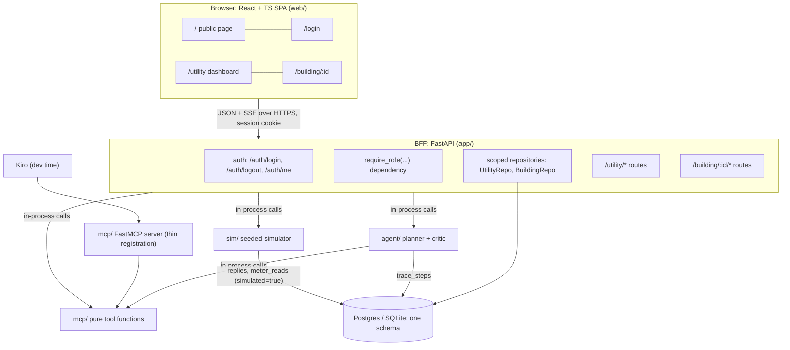
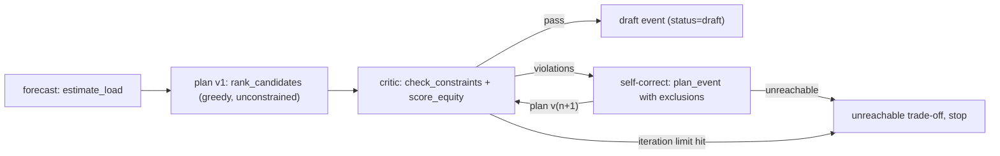

# Design — Commonwatt: Dashboards, Data Model, MCP Tools & Agent Loop

## Overview

This document states the technical approach for everything in
`requirements.md`: the public page, the login flow, the two authenticated
dashboards (`utility` and `building_manager`), the BFF and its access-control
boundary, the Postgres data model and seed, the deterministic Commonwatt MCP
tools, the agent loop (planner + critic), and the simulator.

Fixed decisions carried into this design:

- React 18 + TypeScript + Vite SPA; FastAPI BFF (Python 3.12) + SQLAlchemy.
- One Postgres schema reached through a single `DATABASE_URL`. SQLite via
  SQLAlchemy for local dev and tests; Supabase-hosted Postgres only for the
  deployed demo. No Supabase Auth, no Mongo, no row-level security.
- Auth is a seeded stub: bcrypt hashes, one `/auth/login` route minting an
  HTTP-only SameSite session cookie, and a role-check dependency.
- Exactly two roles: `utility` and `building_manager`. The role comes only from
  the server session (AC-33).
- The BFF calls MCP tool functions and the simulator in-process and streams
  trace events to the SPA.

## Architecture



The SPA talks only to the BFF. The BFF owns the auth boundary, shapes view
models, runs the agent loop, and triggers the simulator after approval. The
same tool functions are registered on a FastMCP server for Kiro to use during
development; the app never goes over MCP transport at runtime.

### Why a BFF and not direct MCP calls

- **Auth boundary.** Scoping to a utility's territory or a single building must
  happen on the server. Every query runs through a scoped repository (below).
- **Shaping.** Map hexes, graph nodes/edges, counters with assumptions, and the
  backfill delta are composed from tool outputs and queries so the client stays
  thin.
- **One tool set, two consumers.** Kiro calls the tools over MCP during
  development; the BFF imports the same functions.

### Why one Postgres schema

- `users.utility_id` and `users.building_id` are real foreign keys, and a CHECK
  constraint ties each to its role (AC-49).
- `audit_log` is append-only and foreign-keyed to users and events.
- SQLite for tests keeps the suite networkless; the deployed demo only swaps
  `DATABASE_URL`. Schema and seed are identical in both.

### Package layout

```
app/        FastAPI BFF: main.py, auth.py, deps.py (require_role),
            scope.py (UtilityRepo, BuildingRepo), routes/utility.py,
            routes/building.py, routes/auth.py, stream.py (SSE)
db/         SQLAlchemy models, Alembic migrations, seed.py
mcp/        commonwatt_mcp/ package: tools/*.py (pure functions),
            schemas.py (typed I/O), constants.py, server.py (FastMCP)
agent/      planner.py, critic.py, loop.py
sim/        simulator.py (seeded, deterministic)
fixtures/   committed BERDO subset, geocodes, zip→utility, EJ zips,
            zip hexes, heat-day intervals
tests/      pytest unit + integration; tests/properties/ (Hypothesis)
web/        React app; web/tests/ (Vitest + RTL); Playwright E2E
```

`mcp/` holds the package `commonwatt_mcp` (no `__init__.py` in `mcp/` itself),
installed via `pyproject.toml` as `packages = [{ include = "commonwatt_mcp",
from = "mcp" }]`. A top-level importable package named `mcp` would shadow the
MCP Python SDK that FastMCP depends on.

## Components and Interfaces

### Front-end stack

| Concern | Choice | Why |
| --- | --- | --- |
| Framework | React 18 + TypeScript (strict) | Named in the brief; fits the dashboard panels |
| Build | Vite | Fast dev server, static build for the public deploy |
| Routing | React Router | `/`, `/login`, guarded `/utility`, `/building/:id` |
| Map | MapLibre GL JS | Open source, no token; hex fill layer + building circle layer |
| Graph | Cytoscape.js | Graph layout and neighbor highlight (AC-14) |
| Data fetching | TanStack Query | Caching, dedupe, re-fetch on slider re-solve (AC-19) |
| Local UI state | Zustand (small) | Most state is server state |
| Charts/counters | Hand-rolled SVG or visx | Three counters + a season bar chart |
| Validation | zod | View-model contracts checked at the fetch boundary |

### Back-end stack

| Concern | Choice | Why |
| --- | --- | --- |
| Framework | FastAPI | Async, dependency injection for role checks, SSE via `StreamingResponse` |
| ORM / migrations | SQLAlchemy 2 + Alembic | Same models on SQLite and Postgres |
| Auth | bcrypt + server-side `sessions` table | Cookie holds an opaque token; role is read from the row |
| MCP | FastMCP registration over pure functions | Tools stay testable without a server |
| Property tests | Hypothesis | Named in stack.md |

### Auth and routing

- **`POST /auth/login`** — body `{email, password}`. Verifies the bcrypt hash,
  inserts a `sessions` row (random 256-bit token, stored hashed, with expiry),
  and sets cookie `cw_session` with `HttpOnly; SameSite=Lax; Secure` (Secure
  off only on localhost). Returns `{role, utilityId, buildingId?}`. Invalid
  credentials return 401 with a generic message (AC-5).
- **`GET /auth/me`** — returns `{role, utilityId, buildingId?}` or 401. For a
  `building_manager`, `utilityId` is derived by joining the building to its zip
  and the zip to `zip_utility`.
- **`POST /auth/logout`** — deletes the session row and clears the cookie
  (AC-8). The SPA then navigates to `/`.
- **SPA routes.** `LoginForm` at `/login` has email and password fields only,
  with no role toggle (AC-2, AC-33). After login the SPA routes from the
  response: `utility` → `/utility`, `building_manager` →
  `/building/{buildingId}` (AC-3, AC-4). `RequireAuth` calls `/auth/me`; a 401
  redirects to `/login` (AC-6). `RequireRole` sends a `building_manager` who
  types `/utility` back to their own building page. The server is the actual
  boundary; the guards only improve UX.

### Access-control boundary (BFF only)

**Role dependency.** Every non-public route declares its role:

```python
router_utility = APIRouter(prefix="/utility",
                           dependencies=[Depends(require_role("utility"))])
router_building = APIRouter(prefix="/building/{building_id}",
                            dependencies=[Depends(require_role("building_manager"))])
```

`require_role(role)` loads the session from the cookie. No session → 401 (the
SPA redirects to `/login`). Wrong role → **404**, so a `building_manager` gets
the same response from a utility route as from a route that does not exist
(AC-7, AC-44). A startup check walks `app.routes` and fails boot if any route
outside the public allowlist (`/auth/login`, `/auth/logout`, `/auth/me`,
`/health`) lacks a `require_role` dependency.

**Pre-auth header stand-in (to be removed by task 4.3).** The chat, SMS and
portfolio routes shipped before the auth layer existed, so they currently read
the caller's identity from `X-User-Id` / `X-Role` request headers ("the BFF
would normally set these from the session"). That shim is NOT the auth model —
it trusts the client to assert its own role. Task 4.3 replaces it: once
`current_user` / `require_role` resolve identity from the `cw_session` cookie,
`routes/chat.py`, `routes/sms.py` and `routes/portfolio.py` must take the user
from that dependency, and the `X-User-Id` / `X-Role` headers must no longer be
honoured on any route.

**Scoped repository pattern.** Route handlers never receive a raw SQLAlchemy
`Session`. They receive a repository bound to the caller's scope:

- `get_utility_repo(session) -> UtilityRepo(db, utility_id)`. Every method
  starts from one helper, `self._scoped(Model)`, which returns
  `select(Model)` joined through `buildings → zips → zip_utility` (or the
  model's own `utility_id` for `events`) and filtered by
  `zip_utility.utility_id == self.utility_id`. No method builds a query any
  other way (AC-45).
- `get_building_repo(building_id: path, session) -> BuildingRepo(db,
  building_id)`. If `building_id != session.building_id` it raises 404 before
  any query runs (AC-46). Every method filters by `self.building_id`. The one
  cross-building read it exposes is `territory_median_calls()`, which returns a
  single aggregate number for AC-27 and no rows.

Three things make the filters hard to forget:

1. `app/routes/*` may not import `sqlalchemy.orm.Session` or `db.engine`; a
   test parses the route modules' imports and fails on a match.
2. The repositories are the only code that touches the models from the BFF.
3. The Hypothesis property for AC-47 (Correctness Properties, Property 1)
   exercises every repository method and every registered route against random
   worlds.

### Screens and components

#### 1. Public page (`/`)
- `PublicLanding` — tagline ("Keep the grid up without leaning on the same
  neighborhoods twice"), a short description (voluntary, paid,
  equity-constrained, human-approved), and a **Log in** link to `/login`. No
  fetch, no auth (AC-1).

#### 2. Login (`/login`)
- `LoginForm` — credential fields only; inline error on 401 (AC-2, AC-5).

#### 3. Utility dashboard (`/utility`)
All data is scoped to the session's `utility_id`.

- **`PortfolioMap`** (MapLibre). AC-9 allows choropleth or hex; this design
  uses **zip-centroid hexes**. At seed time each zip's centroid becomes one
  fixed-radius hexagon polygon, committed as `fixtures/zip_hexes.geojson` and
  served by `/utility/zips/geometry`. The hexes render as a MapLibre `fill`
  layer with a data-driven paint expression. Equal-size hexes keep a large,
  sparse zip from dominating the view, and the layer needs no zip boundary
  shapefile at runtime.
  - `MetricSelect` (load available to reduce / EJ status / cumulative calls)
    re-paints from loaded aggregates and updates `MapLegend` (AC-10).
  - Hex click → `ZipPopover` with building count, load available to reduce, EJ
    status, cumulative calls (AC-11).
  - Drill-in → `/utility/zips/{zip}/buildings` → a `circle` layer at each
    building's geocoded point; marker click → `BuildingPopover` with address,
    type, area, EUI, and load available to reduce (AC-11b). Buildings with
    `basis: "estimated_from_type"` or `null` load show a badge (AC-11c).
  - `OrphanPanel` lists zips with no centroid/hex (AC-12) and buildings with
    `lngLat: null` inside the zip's building list (AC-12b).
  - **`HeatDayReplay`** — a day picker, play/pause, and a step scrubber.
    Fetches `/utility/replay/{day}` (ordered intervals of per-zip values) and
    re-paints the hex layer per interval, showing the interval timestamp
    (AC-34). Under reduced motion, autoplay is off and the user steps
    manually (AC-31).
  - **Load-shift animation** — when a re-solve response carries
    `criticRejection`, the map tweens emphasis from `rejectedZips` to
    `replacementZips` (AC-22), and shows only the end state under reduced
    motion.
- **`KnowledgeGraph`** (Cytoscape) — nodes: zip, building, EJ block group,
  utility, event; edges: building→zip, zip→EJ block group, zip→utility,
  event→building. Select highlights neighbors and shows attributes (AC-13,
  AC-14). From `/utility/graph`.
- **`TracePanel`** — ordered steps with timestamp, kind, one-line summary, plan
  version, verbatim tool name, and the rejecting constraint. Every version
  stays visible (AC-15–AC-17). It loads `/utility/events/{id}/trace` and then
  subscribes to `/utility/events/{id}/trace/stream` (SSE).
- **`OperatorCard`** — window, MW target, building count, EJ share; **Approve /
  Edit list / Reject** (AC-18). `TargetSlider` and `EquityCapSlider` POST
  `/utility/events/{id}/resolve` (debounced); the card, `EquityGauge`, and map
  update in place (AC-19). An unreachable result renders the API's trade-off
  string and disables Approve (AC-20). Approve → `AuditLine` (AC-21). Reject
  → audit line, no contact, trace kept (AC-35). Edit list opens
  `PlanListEditor`. Each removal or addition is a constrained re-solve with an
  explicit include/exclude list, so the edited plan still passes the critic.
- **`ProtectedToggle`** — in `BuildingPopover`, a switch to mark or unmark a
  facility protected, with a reason. PUT
  `/utility/buildings/{id}/protected` persists the flag, writes an audit line,
  and invalidates the draft so the next re-solve applies it (AC-36).
- **`AuditLogPanel`** — user, event, action, timestamp from `/utility/audit`
  (AC-37).
- **`ReplyStream`** — building replies for this utility's events, newest first,
  each tagged **simulated** (AC-37, AC-32). Polls `/utility/replies` every few
  seconds while an event is live.
- **`BackfillDeltaCard`** — after `backfill` runs, lists buildings added and
  removed and the MW change, each number with its `source_id` (AC-38).
- **`SavingsCounters`** — three counters, each labeled **estimated**, with an
  assumptions tooltip and `source_id`. All read zero when nothing has been
  reduced (AC-23, AC-24).
- **`RecruitmentList`** — high-load, unenrolled buildings in EJ zips in the
  territory, from `/utility/recruitment` (AC-25).
- **`SeasonReport`** — cumulative calls by zip with a **cap-on / cap-off**
  toggle that re-requests `/utility/season?cap=on|off` (AC-26). **Export** downloads
  `/utility/season/export?cap=on|off` as CSV (AC-39).

#### 4. Building account (`/building/:id`)
Scoped to the session's building only. No map, zip aggregate, other building,
trace, or operator control (AC-43).

- **`BuildingStatus`** — enrolled capacity, zip, EJ flag, protected flag, last
  called date, season call count beside the territory median (AC-27).
- **`BuildingHistory`** — past asks, replies, delivered kW, payments (AC-41).
- **`LiveAsk`** — rendered only when `/building/{id}/ask` returns an ask, which
  happens only for an **approved**, live event that includes this building. A
  draft or rejected event returns `null` (AC-28, AC-40). Reply control offers
  YES / NO / numeric offer. POST `/building/{id}/reply` and show the stored
  reply (AC-29).
- **`OfferedCapacityForm`** — PUT `/building/{id}/capacity` with a positive kW
  value; shows the stored value and writes an audit line (AC-42).

### BFF route map

| Route | Role | Notes |
| --- | --- | --- |
| `POST /auth/login`, `POST /auth/logout`, `GET /auth/me` | public | session cookie |
| `GET /utility/zips`, `/utility/zips/geometry`, `/utility/zips/{zip}/buildings` | utility | map |
| `GET /utility/replay/{day}` | utility | heat-day intervals |
| `GET /utility/graph` | utility | graph nodes/edges |
| `POST /utility/events` | utility | runs agent loop, returns draft |
| `GET /utility/events/{id}`, `/trace`, `/trace/stream` | utility | SSE stream |
| `POST /utility/events/{id}/resolve`, `/edit`, `/approve`, `/reject` | utility | human gate |
| `GET /utility/events/{id}/backfill` | utility | delta card |
| `PUT /utility/buildings/{id}/protected` | utility | protected flag |
| `GET /utility/audit`, `/utility/replies`, `/utility/savings` | utility | panels |
| `GET /utility/recruitment`, `/utility/season`, `/utility/season/export` | utility | reports |
| `GET /building/{id}/status`, `/history`, `/ask` | building_manager | own building only |
| `POST /building/{id}/reply`, `PUT /building/{id}/capacity` | building_manager | own building only |

A `/utility/*` path parameter such as `{zip}`, `{id}`, or `{day}` that is
outside the session's territory returns 404, the same as a non-existent id.

### View-model contracts

```ts
type Sourced = { value: number; source_id: string; source_url?: string };

type Me = { role: "utility" | "building_manager"; utilityId: string; buildingId?: string };

type ZipAggregate = {
  zip: string;
  buildingCount: number;
  curtailableLoadKw: Sourced | null;  // label in UI: "load available to reduce"
  ejStatus: "ej" | "non_ej" | "unknown";
  cumulativeCalls: Sourced;
  hasGeometry: boolean;               // false → OrphanPanel
};

type BuildingMarker = {
  buildingId: string; address: string; zip: string;
  lngLat: [number, number] | null;    // null → listed, not dropped
  propertyType: string; grossAreaSf: Sourced; siteEui: Sourced | null;
  protected: boolean;
  curtailableLoadKw: (Sourced & { basis: "metered" | "estimated_from_type" }) | null;
};

type EventPlan = {
  eventId: string; version: number; status: "draft" | "approved" | "rejected";
  windowLabel: string; targetMw: Sourced; capPct: number;
  buildingCount: number; ejSharePct: Sourced;
  reachable: boolean;
  tradeoff?: { capPct: number; achievableMw: number; source_id: string }[];
  tradeoffLabel?: string;             // "35% cap → 31 MW; 45% → 40 MW"
  criticRejection?: { constraint: string; rejectedZips: string[]; replacementZips: string[] };
};

type TraceStep = {
  ts: string; kind: "forecast" | "plan" | "constraint_check" | "self_correct" | "resolve" | "unreachable";
  summary: string; planVersion?: number; toolName?: string; rejectedBy?: string;
};

type BackfillDelta = {
  added: { buildingId: string; kw: Sourced }[];
  removed: { buildingId: string; kw: Sourced }[];
  deltaMw: Sourced;
};

type SavingsCounter = {
  key: "paid_to_buildings" | "avoided_system_cost" | "co2_avoided";
  value: Sourced; estimated: true; assumptions: string;
};

type BuildingStatus = {
  enrolledCapacityKw: Sourced; offeredCapacityKw: Sourced | null;
  zip: string; ej: boolean; protected: boolean;
  lastCalled: string | null; seasonCalls: Sourced; territoryMedianCalls: Sourced;
  enrollmentSimulated: true;
};

type LiveAsk = {
  eventId: string; windowLabel: string; kwRequested: Sourced;
  reason: string; estimatedPayment: Sourced & { estimated: true };
  reply?: { kind: "yes" | "no" | "offer"; offerKw?: number; simulated: boolean };
} | null;
```

`<Num value={...}/>` is the only component that renders numbers. It refuses to
render without `source_id` and shows the source id on hover/focus (AC-30). User
text passes through a copy linter (a unit test over `web/src` strings) that
fails on "cut", "shut off", "curtail", or "disconnect" (AC-70). Internal field
names such as `curtailableLoadKw` are not user-facing.

## Data Models

### Schema

| Table | Columns (key ones) | Notes |
| --- | --- | --- |
| `utilities` | id, name, source_id | one row per utility company |
| `zips` | zip PK, ej bool, ej_source_id, centroid_lng, centroid_lat | `ej` per zip (AC-50) |
| `zip_utility` | zip PK/FK, utility_id FK, town, source_id | territory mapping from the utility-by-town dataset joined to zip |
| `buildings` | id (BERDO BUILDING_ID), zip FK, address, property_type, gross_area_sf, site_eui, per_electricity, lng, lat, geocode_status, enrolled, enrolled_capacity_kw, offered_capacity_kw, protected, protected_reason, protected_kind, simulated | `simulated` marks seeded enrollment |
| `users` | id, email unique, role, utility_id FK NULL, building_id FK NULL, password_hash, created_at | CHECK: `(role='utility' AND utility_id IS NOT NULL AND building_id IS NULL) OR (role='building_manager' AND building_id IS NOT NULL AND utility_id IS NULL)` (AC-49) |
| `sessions` | id, token_hash unique, user_id FK, created_at, expires_at | server-side session |
| `events` | id, utility_id FK, window_start, window_end, window_label, target_mw, cap_pct, heat_threshold_exceeded, status (`draft`/`approved`/`rejected`), current_version, approved_by, approved_at, created_at | |
| `plan_buildings` | event_id FK, plan_version, building_id FK, kw_requested, reason | membership of every plan version, draft or final |
| `call_history` | id, event_id FK, building_id FK, kw_requested, reason, est_payment, created_at | written **only on approval**: a row is a contact (AC-48) |
| `replies` | id, call_id FK, building_id FK, kind (`yes`/`no`/`offer`), offer_kw, ts, simulated | |
| `meter_reads` | id, call_id FK, building_id FK, interval_start, kw, ts, simulated | |
| `heat_day_intervals` | id, utility_id FK, day, interval_start, zip FK, load_kw, participating_kw, source_id, simulated | replay (AC-34) |
| `trace_steps` | id, event_id FK, ts, kind, summary, plan_version, tool_name, rejected_by | |
| `audit_log` | id, user_id FK, event_id FK NULL, building_id FK NULL, action, detail, ts | append-only |

`audit_log.action` ∈ `approved`, `rejected`, `edited`, `resolved`,
`protected_set`, `protected_cleared`, `reply_submitted`, `capacity_updated`.
Utility scope for events and trace is `events.utility_id`. For buildings,
calls, replies, and meter reads it is `buildings.zip → zip_utility.utility_id`.

### Fixtures and seed (networkless)

`make setup` runs Alembic migrations and `db/seed.py`. The seed reads only
committed files under `fixtures/`:

- `berdo_subset.csv` — a few hundred BERDO rows from datastore resource
  `43e4abc9-1fae-40d9-a02e-ff950bd0e732`. The subset covers every Boston zip in
  BERDO, includes rows missing EUI or electricity share (for AC-11c), and
  includes the three demo buildings.
- `berdo_geocodes.csv` — pre-geocoded `(BUILDING_ID, lng, lat, status)`,
  produced once offline by `scripts/geocode_berdo.py`. Setup never runs that
  script. Rows with failed geocoding are kept with null coordinates (AC-12b).
- `zip_utility.csv` — town → utility joined to zip, with the dataset source id
  and URL in the header row (AC-50).
- `ej_zips.csv` — MA EJ block groups joined to zip. A zip is flagged EJ if any
  EJ block group centroid falls inside it. The rule and source id are
  recorded in the file header.
- `zip_hexes.geojson` — one hexagon per zip centroid.
- `heat_day.csv` — interval values for one replay day, marked simulated.

Seeded accounts (documented in README under "Demo accounts", AC-53):

| Email | Password | Role | Scope |
| --- | --- | --- | --- |
| `utility@demo` | `demo-utility-pass` | utility | the utility serving the Boston zips in BERDO (AC-51) |
| `building1@demo` | `demo-building-pass` | building_manager | a BERDO building in an EJ zip |
| `building2@demo` | `demo-building-pass` | building_manager | a BERDO building flagged protected (different zip) |
| `building3@demo` | `demo-building-pass` | building_manager | a BERDO building in a third zip |

No sign-up or password-reset routes exist (AC-54). Seeded enrollment,
capacities, and history rows carry `simulated = true` (AC-32).

## Agent Loop

The agent loop lives in `agent/loop.py`. The planner and critic are
deterministic Python. They call the tool functions in-process, and their
summaries are templated strings filled from tool output. Running the loop is
`POST /utility/events`:



1. **Forecast.** `estimate_load` for every enrolled candidate in the
   utility's territory.
2. **Plan v1.** `rank_candidates` picks a greedy, load-first list toward the
   target. This is a proposal, not a `plan_event` result, so it may violate
   constraints. That is what gives the critic something real to reject.
3. **Critic.** `check_constraints` (EJ cap, previous-event exclusion, protected
   facilities under heat threshold) and `score_equity`. Each violation names
   the constraint and the offending buildings (AC-60).
4. **Self-correct.** `plan_event` with the offending buildings excluded and the
   constraints enforced. It returns either a plan that satisfies them
   (AC-56, AC-58, AC-59) or `unreachable` with the trade-off (AC-57).
5. The critic re-checks the new version. The loop stops on pass, on
   `unreachable`, or at `MAX_PLAN_ITERATIONS` (default 3, in config). At the
   limit it calls `plan_event` in trade-off mode and returns the unreachable
   result (AC-68).

Every step appends a `trace_steps` row (ts, kind, summary, plan_version,
tool_name, rejected_by) and publishes it to the event's SSE stream (AC-65).
Every version's membership is written to `plan_buildings`, so rejected and
accepted versions both survive (AC-66). The loop ends with `status = draft` and
writes no `call_history` (AC-67).

**Re-solve** (`/resolve`, `/edit`) calls `plan_event` and then the critic
directly with the slider values or edit list, and appends a new version plus
`resolve` trace steps. **Approve** requires a reachable current version. It
copies that version's `plan_buildings` into `call_history`, writes the audit
line, calls the mock `notify`, and starts the simulator for the event.
**Reject** writes the audit line and changes nothing else (AC-35, AC-48).

## Tools / MCP

Each tool is a pure function in `commonwatt_mcp/tools/`, typed with pydantic
models in `schemas.py`. The function takes plain data (candidate rows,
constants, config) and returns data. It does no database access, no clock
reads, and no randomness. The BFF loads rows and passes them in. `server.py`
registers each function with FastMCP using a thin wrapper:

```python
mcp = FastMCP("commonwatt")
@mcp.tool()
def plan_event(req: PlanEventInput) -> PlanEventOutput:
    return tools.plan_event.run(req)
```

| Tool | Input → Output (summary) | Key rules |
| --- | --- | --- |
| `estimate_load` | building attrs → `{value, basis, source_id, source_url}` or `{unavailable, reason}` | never an unlabeled number (AC-61) |
| `rank_candidates` | candidates + target → ordered list | stable tie-break by `building_id` |
| `check_constraints` | plan + context → `[{constraint, building_ids}]` | names constraint and offenders (AC-60) |
| `score_equity` | plan + zip EJ flags → EJ share (sourced) | |
| `plan_event` | candidates, target, cap, previous-event set, protected set, heat flag → plan or `unreachable{tradeoff[]}` | cap, previous-event, protected rules (AC-56–59) |
| `backfill` | plan, declines/shortfalls, candidates → new plan + delta | same constraints as `plan_event` |
| `reconcile` | replies + meter reads → per-building delivered kW + total | per-building sum equals total (AC-64) |
| `estimate_savings` | delivered kW + constants → three estimated figures + assumptions | labeled estimated (AC-63) |
| `recruitment_list` | buildings + EJ flags → high-load, unenrolled, EJ-zip buildings | |
| `notify` | approved call list → mock outbound messages | backend mock only |

Determinism (AC-55): every tool sorts its inputs by a stable key before
iterating, uses `Decimal` or fixed rounding for money and MW, and avoids
iterating over sets or dicts in hash order.

**Constants module.** `commonwatt_mcp/constants.py` defines each program rate,
capacity price, LMP, and emissions factor as
`Constant(value, unit, source_id, source_url, retrieved, note)`, with one
citation per constant (AC-62). Tools read only from this module. A test checks
that every `Constant` has a non-empty `source_url` and that `tools/` contains no
float literals other than 0 and 1. A constant without a confirmed citation is
not given a value. Any figure that depends on it returns `unavailable` with the
reason.

**Simulator** (`sim/simulator.py`). `simulate(event, calls, seed)` uses a local
`random.Random(seed)`. The default seed is a SHA-256 digest of `event_id`,
because Python's built-in `hash` is salted per process. It generates YES / NO / offer
replies and interval meter reads for the called buildings and returns rows
with `simulated = True`. The BFF persists them (AC-69). Same seed and inputs
produce the same rows.

## Constraints and Invariants

- **Two roles, session-derived (AC-33, AC-49).** Role and scope come from the
  `sessions` → `users` row; the client never sends a role.
- **Scope (AC-45–AC-47).** Utility queries go through `UtilityRepo._scoped`;
  building queries go through `BuildingRepo`, which 404s on id mismatch. A
  wrong role also returns 404.
- **Human gate (AC-18, AC-48, AC-67).** `call_history`, `notify`, and the
  simulator run only inside `/approve`. No other code path writes
  `call_history`.
- **EJ cap, previous event, protected facilities (AC-56–AC-59).** Enforced in
  `plan_event` and `backfill` and re-checked by the critic. An over-cap plan is
  never returned; the result is `unreachable` with the trade-off instead.
- **No silent shortfall (AC-20, AC-57).** An unreachable plan shows the
  trade-off and disables Approve.
- **Provenance (AC-30, AC-62).** Every number crosses the API as `Sourced`, and
  `<Num>` refuses to render without a source.
- **No fabricated load, no silent drops (AC-11c, AC-12, AC-12b).**
- **Simulated labeled (AC-32, AC-69).** Rows carry `simulated`, and the UI shows
  the tag.
- **Wording (AC-70).** The copy linter blocks banned terms.
- **Reduced motion (AC-31).** Load-shift tween, replay autoplay, and counter
  roll-ups are off under `prefers-reduced-motion`; the end state is shown.
- **Accessibility.** Controls are keyboard-reachable. Map and graph have table
  fallbacks. Color scales are colorblind-safe and paired with legend and
  numbers.

## Correctness Properties

*A property is a characteristic or behavior that should hold true across all valid executions of a system-essentially, a formal statement about what the system should do. Properties serve as the bridge between human-readable specifications and machine-verifiable correctness guarantees.*

Generators live in `tests/properties/strategies.py`. They build random worlds:
utilities, zips mapped to utilities with random EJ flags, buildings with
optional EUI or electricity share, protected flags, previous-event sets,
events, calls, replies, and meter reads.

### Property 1: Scope isolation

For any random world, any `utility` session, and any `building_manager`
session, every `UtilityRepo` method and every `/utility/*` route returns only
rows whose utility (via `zip_utility` or `events.utility_id`) equals the
session's `utility_id`. Every `BuildingRepo` method and every
`/building/{id}/*` route returns only rows whose `building_id` equals the
session's `building_id`. `territory_median_calls` is the one exception: it
returns a single number and no rows.

**Validates: Requirements AC-45, AC-47, AC-25, AC-39, AC-43**

### Property 2: 404 non-enumeration

For any `building_manager` session and any building id other than its own,
whether it exists in this territory, another territory, or nowhere, every
`/building/{id}/*` route returns 404 with the same body. Every `/utility/*`
route called by a `building_manager` session also returns that 404. The
responses do not let a caller tell an existing id from a missing one.

**Validates: Requirements AC-46, AC-7, AC-44**

### Property 3: Tool determinism

For any valid input to `estimate_load`, `rank_candidates`, `check_constraints`,
`score_equity`, `plan_event`, `backfill`, `reconcile`, `estimate_savings`, or
`recruitment_list`, two calls on the input, and one call on a permutation of
its list fields, return equal outputs.

**Validates: Requirements AC-55**

### Property 4: EJ share never exceeds the cap

For any candidate set, target, and cap, if `plan_event` or `backfill` returns a
plan, its EJ share is ≤ the cap. Otherwise the result is `unreachable` with a
non-empty trade-off list, and every entry's achievable MW at the current cap
is below the target.

**Validates: Requirements AC-56, AC-57, AC-20**

### Property 5: Previous-event buildings excluded

For any candidate set and previous-event building set, no plan returned by
`plan_event` or `backfill` contains a building from the previous event.

**Validates: Requirements AC-58**

### Property 6: Protected facilities excluded under heat

For any candidate set with random protected flags and kinds, whenever
`heat_threshold_exceeded` is true, no plan returned by `plan_event` or
`backfill` contains a protected building.

**Validates: Requirements AC-59, AC-36**

### Property 7: Reconcile sums

For any set of replies and meter reads for an event, the per-building delivered
kW from `reconcile` sums exactly (Decimal) to its reported total.

**Validates: Requirements AC-64**

### Property 8: Critic matches a reference oracle

For any plan and context, `check_constraints` reports exactly the set of
`(constraint, building_id)` pairs that a naive reference implementation
computes.

**Validates: Requirements AC-60**

### Property 9: No unlabeled numbers from tools

For any building input to `estimate_load`, the output is either a value with
`basis`, `source_id`, and `source_url`, or `unavailable` with a reason. For any
`estimate_savings` output, every figure has `estimated = true` and non-empty
assumptions.

**Validates: Requirements AC-61, AC-62, AC-63**

### Property 10: Agent loop keeps versions and contacts no one

For any random world, after the agent loop and any sequence of resolve, edit,
and reject actions with no approve: versions in `trace_steps` and
`plan_buildings` are contiguous from 1, none have been deleted, the status is
`draft` or `rejected`, `call_history` is empty, `notify` was not called, and
`/building/{id}/ask` returns `null` for every building. The last version either
passes `check_constraints` or is `unreachable`.

**Validates: Requirements AC-48, AC-40, AC-65, AC-66, AC-67, AC-68, AC-35**

### Property 11: Simulator determinism

For any event, call list, and seed, `simulate` returns identical rows on
repeated calls, and every row has `simulated = True`.

**Validates: Requirements AC-69, AC-32**

## Error Handling

| Condition | Response | UI |
| --- | --- | --- |
| No or expired session | 401 | redirect to `/login` |
| Wrong role, out-of-scope id, or mismatched building id | 404 (identical body) | not-found view |
| Bad credentials | 401, generic message | inline error, stay on `/login` |
| Invalid body (e.g. non-positive capacity, malformed offer) | 422 | field error |
| Approve on a non-draft or unreachable version | 409 | message; Approve stays disabled |
| Tool value unavailable | 200 with `{unavailable, reason}` | "unavailable" plus reason, never a number |
| `users` CHECK or FK violation in seed | seed aborts with the row named | — |
| SSE disconnect | client reconnects with `Last-Event-ID`; server replays from `trace_steps` | trace stays complete |

## Testing Strategy

- **Property tests (Hypothesis, `tests/properties/`).** One test per property
  above, with `@settings(max_examples=100)` or more. Each is tagged with a
  comment such as `# Feature: project, Property 4: EJ share never exceeds the
  cap`. Route-level properties (1, 2, 10) run against FastAPI `TestClient` on
  in-memory SQLite and iterate over `app.routes`, so a new route is covered
  automatically.
- **Backend unit/example (pytest).** The `users` CHECK constraint (AC-49), the
  boot check that every route has a role (AC-44), the import ban on `Session`
  in `app/routes`, constants citations (AC-62), seed contents and demo accounts
  (AC-50–AC-54), savings zero case (AC-24), the backfill delta arithmetic
  (AC-38), and login/logout/me flows (AC-3–AC-5, AC-8).
- **Front-end unit (Vitest + RTL, mocked BFF fixtures).** Route guards (AC-6,
  AC-7), `<Num>` refusal (AC-30), badges (AC-11c), `LiveAsk` null for
  draft/rejected (AC-40), reply and capacity forms (AC-29, AC-42), building
  page has no utility panels (AC-43), copy linter (AC-70).
- **Contract.** zod schemas for the view models validated against recorded BFF
  responses.
- **E2E (Playwright, seeded DB + live BFF).** Log in as each demo account. Run
  the map metric switch, drill-in, orphan panel, heat-day replay, and slider
  re-solve with an unreachable trade-off. Approve and confirm the audit line,
  simulated replies in the stream, and the building's live ask. Reject and
  confirm no ask. Toggle protected, then re-solve. Export the season CSV.
  Check reduced-motion emulation (AC-31) and run axe on each screen.

## Deviations from the previous design.md

1. Roles `operator` / `city` / `facility_manager` replaced by `utility` and `building_manager`, because requirements now define exactly two account types and put recruitment and season views in the utility account.
2. `/signin` with a role toggle replaced by `/login` with credentials only, because AC-2 and AC-33 forbid a client-side role choice.
3. Building route is `/building/:id` instead of `/building`, because AC-4 redirects to the session's building id.
4. Wrong-role and building-id-mismatch responses are 404 instead of 403, so building ids cannot be enumerated (AC-46).
5. Added the scoped-repository pattern (`UtilityRepo`, `BuildingRepo`), the boot-time check that every route declares a role, and the route import ban, so scope filters cannot be skipped (AC-44, AC-45).
6. BFF routes moved under the `/utility/*` and `/building/{id}/*` prefixes (previously `/zips`, `/graph`, `/event/*`, `/recruitment`, `/season`, `/savings`), so one router-level role dependency covers each group.
7. `/auth/me` now returns `utilityId`, and `/auth/logout` was added, because scope is per utility and AC-8 requires sign-out.
8. The cookie holds an opaque token whose hash is stored in `sessions`, instead of carrying role and buildingId, so the role is read only from the server (AC-33).
9. The zip-polygon choropleth became zip-centroid hexes in a MapLibre fill layer from a committed GeoJSON, with building drill-in kept. AC-9 allows hex, and this removes the runtime zip-boundary dependency.
10. Added the heat-day replay, audit log panel, reply stream, backfill delta card, protected toggle, season export, and offered-capacity form, because they are new in-scope requirements (AC-34–AC-39, AC-42).
11. The data model adds `utilities`, `zip_utility`, `zips.ej`, `events.utility_id`, building `protected` / `enrolled_capacity_kw` / `offered_capacity_kw`, `sessions`, `meter_reads`, `heat_day_intervals`, and `simulated` flags, for territory scope and the new ACs.
12. Added `plan_buildings` for per-version plan membership, and `call_history` is written only on approval, so a contact can only happen behind the human gate (AC-48, AC-66).
13. Backend components are now designed (tools, agent loop, simulator, constants, seed), because the backend is in scope.
14. The tool package is `commonwatt_mcp` inside `mcp/`, not a top-level `mcp` package, because a top-level `mcp` would shadow the MCP SDK that FastMCP imports.
15. The planner and critic are deterministic code with v1 from unconstrained `rank_candidates` and corrections via `plan_event`. This keeps AC-55 determinism and AC-56 (every `plan_event` plan within the cap) while still giving the critic a real rejection to show.
16. The trace is streamed over SSE with replay from `trace_steps`, in place of an unspecified stream, so reconnects do not lose steps.
17. Setup uses a committed BERDO subset plus pre-geocoded coordinates instead of geocoding all 2,472 rows at ingest, so a clean clone needs no network.
18. Seed accounts changed to one utility and three building managers (EJ zip, protected, third zip), per AC-51 and AC-52.
19. Zip EJ flag rule set as "any EJ block group centroid in the zip", recorded with its source, because the join rule was previously unstated.
20. Constants are `Constant` records with a citation each, and an uncited constant yields "unavailable", per the provenance steering rule.
21. Numbers render only through a single `<Num>` component, and a copy linter enforces banned words, so AC-30 and AC-70 are enforced in one place.
22. Edit list is a constrained re-solve, and Approve is disabled on unreachable versions, so an edited or short plan cannot bypass the critic.
23. The testing strategy adds Hypothesis properties and removes the stale Mongo reference.
24. The section headings "Components" and "Data Sources" are now "Components and Interfaces" and "Data Models", because the spec format validator requires those names. The content and order are unchanged.
