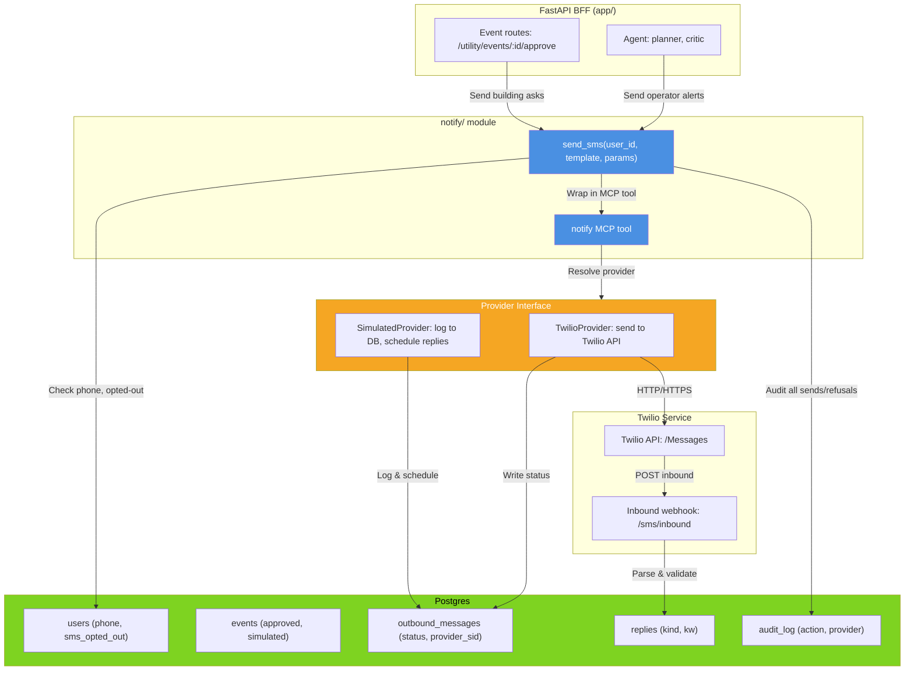
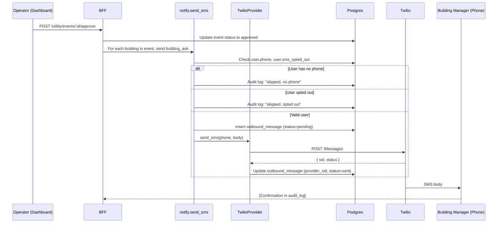
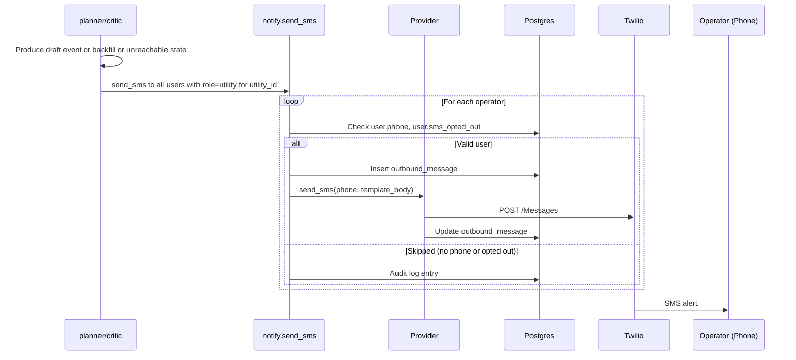
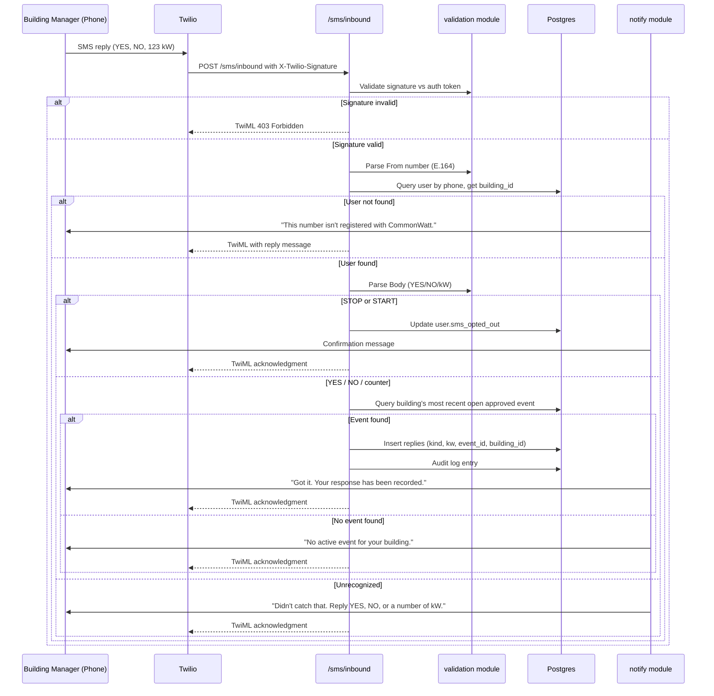

# Design Document: SMS Notifications

## Overview

This document specifies the technical approach for adding SMS as a delivery channel for operator alerts and building manager requests in CommonWatt. The feature integrates Twilio for outbound messages and inbound webhook parsing, maintains a Provider abstraction for testing and demo modes, and enforces safety and access-control rules throughout.

Outbound flows: (1) building managers receive SMS asks on event approval, (2) operators receive alerts for draft-ready, backfill-needed, and unreachable states. Inbound: building managers reply YES/NO/kW via SMS webhook, which parses the reply and writes to the `replies` table for backfill logic to consume.

All messages follow safety.md rules: no "cut", "shut off", "curtail", or "disconnect" language. Demo mode restricts outbound to an allowlisted phone numbers. Inbound validation rejects tampered Twilio signatures and unknown numbers. All state is persisted: outbound messages, inbound replies, provider details, and audit entries.

## Architecture



### Package Layout

```
app/
  routes/
    events.py          — POST /utility/events/:id/approve calls notify.send_sms
    sms.py             — POST /sms/inbound webhook (TwiML response)
  deps.py              — require_operator, require_role helpers

notify/
  __init__.py
  models.py            — send_sms(user_id, template, params) function
  provider.py          — Provider ABC, TwilioProvider, SimulatedProvider
  templates.py         — Template strings (building_ask, operator_*)
  validation.py        — Signature validation, reply parser

mcp/
  commonwatt_mcp/
    notify.py          — notify MCP tool (wraps send_sms, enforces building_id)

db/
  models.py            — Users, Events, OutboundMessage, audit_log columns
  migrations/          — Alembic: add users.phone, users.sms_opted_out, 
                         outbound_messages table

tests/
  unit/
    test_notify.py     — Unit tests for send_sms, template rendering
    test_provider.py    — Provider interface, SimulatedProvider behavior
    test_parser.py      — Inbound parser: YES/NO/kW/unrecognized
  integration/
    test_webhook.py    — POST /sms/inbound: signature validation, reply write
    test_workflow.py    — End-to-end: approve event → building asks sent
  properties/
    test_notify_access.py — Hypothesis: never send for building not in event
    test_notify_optout.py — Hypothesis: never send to sms_opted_out=true
    test_demo_mode.py    — Hypothesis: demo mode never contacts unlisted numbers
    test_parser.py      — Hypothesis: parser correctness, counter validation
    test_templates.py    — Hypothesis: templates never contain forbidden words
    test_signature.py    — Hypothesis: signature validation rejects tampering
```

## Sequence Diagrams

### Outbound: Event Approval → Building Asks



### Outbound: Operator Alerts (draft-ready, backfill, unreachable)



### Inbound: Reply Webhook



## Components and Interfaces

### Component 1: Provider Interface (notify/provider.py)

**Purpose:** Abstract outbound SMS sending to support Twilio, simulated (for demo/test), and future providers.

**Interface:**

```python
from abc import ABC, abstractmethod
from dataclasses import dataclass
from typing import Optional

@dataclass
class SMSResult:
    """Outcome of an SMS send operation."""
    success: bool
    provider_sid: Optional[str]  # Twilio SID or simulated identifier
    error: Optional[str]  # Error message if not successful

class Provider(ABC):
    """Abstract base for SMS providers."""
    
    @abstractmethod
    async def send(
        self, 
        phone: str,           # E.164 format
        body: str,            # Plain text message
    ) -> SMSResult:
        """Send SMS. Returns SMSResult with provider_sid on success."""
        pass

class TwilioProvider(Provider):
    """Live Twilio provider."""
    
    def __init__(
        self,
        account_sid: str,
        auth_token: str,
        from_number: str,     # E.164 format
        demo_mode: bool = False,
        demo_allowlist: Optional[list[str]] = None,  # E.164 numbers
    ):
        self.account_sid = account_sid
        self.auth_token = auth_token
        self.from_number = from_number
        self.demo_mode = demo_mode
        self.demo_allowlist = demo_allowlist or []
    
    async def send(self, phone: str, body: str) -> SMSResult:
        """Send via Twilio. If demo_mode and phone not in allowlist, drop."""
        pass

class SimulatedProvider(Provider):
    """Testing/demo provider that logs to DB instead of calling Twilio."""
    
    def __init__(self, db_session):
        self.db_session = db_session
    
    async def send(self, phone: str, body: str) -> SMSResult:
        """Log to outbound_messages, optionally schedule scripted reply."""
        pass
```

**Responsibilities:**
- Encapsulate credential handling and provider-specific logic
- Return SMSResult with provider_sid for auditability
- Enforce demo-mode allowlisting (TwilioProvider only)
- Log all sends to outbound_messages table with provider_sid

### Component 2: Notify Module (notify/models.py)

**Purpose:** High-level send_sms function that orchestrates template rendering, DB state checks, provider selection, and audit logging.

**Interface:**

```python
async def send_sms(
    user_id: int,
    template: str,            # "building_ask", "operator_draft_ready", etc.
    params: dict,             # Template substitution parameters
    event_id: Optional[int] = None,  # For building_ask; optional for operator alerts
    db_session = None,        # Injected for testing
    provider: Optional[Provider] = None,  # Injected for testing
) -> dict:
    """
    Send SMS to a single user if eligible.
    
    Returns:
        {
            "sent": bool,
            "reason_skipped": Optional[str],  # if not sent
            "provider_sid": Optional[str],    # if sent
        }
    
    Raises:
        ValueError if template not recognized
        ValueError if required params missing
    """
    pass
```

**Behavior:**
- Resolve user by user_id; check phone (not null) and sms_opted_out
- If not eligible, return skipped reason and audit log
- Render template with params (raise on missing keys)
- Create outbound_message row (status=pending)
- Call provider.send(phone, body)
- Update outbound_message row with provider_sid and final status
- Audit log all sends and refusals
- Return sent/skipped status

### Component 3: Templates (notify/templates.py)

**Purpose:** Plain-text SMS templates for all notification types, validated to exclude forbidden language per safety.md.

**Templates:**

```python
TEMPLATES = {
    "building_ask": (
        "CommonWatt: Demand response event {window}. Your building ({building_name}) "
        "is asked to reduce {kw_requested} kW of {kw_enrolled} kW enrolled. "
        "Why you: {reason}. Est. payment ${payment}. "
        "Reply YES, NO, or a number (kW you can offer)."
    ),
    "operator_draft_ready": (
        "CommonWatt: Draft event ready. {window}, {target_mw} MW, {building_count} buildings, "
        "EJ share {ej_share}%. Open the dashboard to approve."
    ),
    "operator_backfill": (
        "CommonWatt: {decline_count} declines (−{shortfall_mw} MW). "
        "Backfill proposed, needs your approval."
    ),
    "operator_unreachable": (
        "CommonWatt: Target unreachable under the {cap}% EJ cap. "
        "Achievable {achievable_mw} MW. Decide: raise cap or accept."
    ),
}

def get_template(template_name: str) -> str:
    """Retrieve template string; raise KeyError if not found."""
    pass

def validate_templates():
    """Assert no template contains: cut, shut off, curtail, disconnect."""
    pass
```

**Validation Rules:**
- All template strings checked at module load: no "cut", "shut off", "curtail", "disconnect"
- Template params must match placeholders (unit tests and type hints catch mismatches)
- Rendered bodies must be ≤160 characters (SMS standard)

### Component 4: Inbound Webhook (app/routes/sms.py)

**Purpose:** Receive Twilio inbound SMS webhook, validate signature, parse reply, write to replies table.

**Interface:**

```python
from fastapi import APIRouter, Request, Depends
from db.models import User, Event, Reply
from notify.validation import validate_signature, parse_reply_body

router = APIRouter()

@router.post("/sms/inbound", tags=["sms"])
async def inbound_webhook(
    request: Request,
    db_session = Depends(get_db),
) -> TwiMLResponse:
    """
    Receive Twilio inbound webhook.
    
    Expected POST body (form-encoded):
      - From: E.164 phone number
      - Body: User reply (YES, NO, kW, STOP, START, etc.)
      - MessageSid: Twilio SID
      - X-Twilio-Signature: HMAC-SHA1(auth_token, request_body)
    
    Returns TwiML response with SMS body for Twilio to send back.
    """
    pass
```

**Logic:**
1. Extract X-Twilio-Signature header; validate via validation.validate_signature()
2. Parse form-encoded body: From, Body, MessageSid
3. Match From to users.phone (E.164); if not found, reply with "not registered" + return
4. Parse Body case-insensitively (YES/NO/kW/STOP/START/unrecognized)
5. If STOP: set user.sms_opted_out = true, reply "You've opted out...", audit, return
6. If START: set user.sms_opted_out = false, reply "You're opted in...", audit, return
7. If YES/NO/counter:
   - Query user.building_id
   - Query events where building_id IN event.buildings and status=approved and closed_at IS NULL
   - If found: write replies row (building_id, event_id, kind, kw, timestamp), audit, reply "Got it. Your response has been recorded."
   - If not found: reply "No active event for your building.", return
8. If unrecognized: reply "Didn't catch that. Reply YES, NO, or a number of kW."
9. Always return TwiML; never raise (Twilio retries on non-2xx)

### Component 5: Validation Module (notify/validation.py)

**Purpose:** Signature validation, reply parsing, input sanitization.

**Interface:**

```python
from typing import Union

def validate_signature(
    body: bytes,
    signature: str,
    auth_token: str,
    url: str = "https://commonwatt.example.com/sms/inbound",
) -> bool:
    """
    Validate Twilio X-Twilio-Signature HMAC.
    
    Computes: HMAC-SHA1(auth_token, url + body_params_in_order)
    Returns True if signature matches, False otherwise.
    """
    pass

def parse_reply_body(body: str) -> Union[str, int, None]:
    """
    Parse SMS reply body.
    
    Returns:
        "yes" or "no" (lowercase, case-insensitive input)
        positive int (kW value, e.g., 50 from "50" or "50 kw")
        None if unrecognized
    
    Logic:
        - Strip whitespace, lowercase
        - If "yes" → return "yes"
        - If "no" → return "no"
        - If "stop" → return "STOP" (handled at webhook level)
        - If "start" → return "START" (handled at webhook level)
        - If integer or "N kw" → return int if positive, else None
        - Else → return None
    """
    pass
```

**Validation Rules:**
- Signature validation uses Twilio's published algorithm (HMAC-SHA1)
- Parser is case-insensitive and whitespace-tolerant
- Counter must be a positive integer (0 is invalid)
- All validation failures logged to audit_log

## Data Models

### Schema Changes (db/models.py)

**users table additions:**

```python
class User(Base):
    __tablename__ = "users"
    
    id: Mapped[int] = mapped_column(primary_key=True)
    email: Mapped[str] = mapped_column(String, unique=True)
    role: Mapped[str] = mapped_column(String)  # "utility", "building_manager"
    utility_id: Mapped[Optional[int]] = mapped_column(ForeignKey("utilities.id"))
    building_id: Mapped[Optional[int]] = mapped_column(ForeignKey("buildings.id"))
    password_hash: Mapped[str] = mapped_column(String)
    
    # NEW: SMS fields
    phone: Mapped[Optional[str]] = mapped_column(String, nullable=True, unique=True)
    # E.164 format, e.g. "+12025551234"; unique to avoid duplicates
    sms_opted_out: Mapped[bool] = mapped_column(Boolean, default=False)
    # True if user replied STOP; never send SMS to opted-out users
    
    created_at: Mapped[datetime] = mapped_column(DateTime, default=datetime.utcnow)
    updated_at: Mapped[datetime] = mapped_column(DateTime, default=datetime.utcnow, onupdate=datetime.utcnow)
```

**New outbound_messages table:**

```python
class OutboundMessage(Base):
    __tablename__ = "outbound_messages"
    
    id: Mapped[int] = mapped_column(primary_key=True)
    user_id: Mapped[int] = mapped_column(ForeignKey("users.id"), nullable=False)
    event_id: Mapped[Optional[int]] = mapped_column(ForeignKey("events.id"))
    # event_id nullable: operator alerts may not tie to a single event
    
    template: Mapped[str] = mapped_column(String)
    # Template name: "building_ask", "operator_draft_ready", etc.
    
    body: Mapped[str] = mapped_column(String)
    # Rendered SMS body (for audit and replay)
    
    provider: Mapped[str] = mapped_column(String)
    # "twilio", "simulated"
    
    status: Mapped[str] = mapped_column(String, default="pending")
    # "pending", "sent", "failed", "skipped"
    
    provider_sid: Mapped[Optional[str]] = mapped_column(String, nullable=True)
    # Twilio SID (e.g. "SMxxx...") or simulated ID
    
    error: Mapped[Optional[str]] = mapped_column(String, nullable=True)
    # Error message if status=failed or skipped
    
    created_at: Mapped[datetime] = mapped_column(DateTime, default=datetime.utcnow)
    updated_at: Mapped[datetime] = mapped_column(DateTime, default=datetime.utcnow, onupdate=datetime.utcnow)
```

**audit_log table additions:**

audit_log already exists. SMS adds these action types:
- "sms_sent": outbound SMS dispatched to Twilio (log provider_sid)
- "sms_skipped": outbound SMS skipped (no phone, opted out, etc.)
- "sms_received": inbound SMS parsed and written to replies
- "sms_opted_out": user replied STOP
- "sms_opted_in": user replied START

## Key Functions with Formal Specifications

### Function 1: send_sms(user_id, template, params, event_id, db_session, provider)

**Preconditions:**
- user_id exists in users table
- template is a key in notify.templates.TEMPLATES
- params dict contains all required substitution keys for the template
- If template="building_ask", event_id must be provided and non-null
- event_id (if provided) corresponds to an event in the database
- provider is not None (resolved from config or injected)
- db_session is valid and transactional

**Postconditions:**
- If user.phone is null or user.sms_opted_out = true:
  - Returns {"sent": false, "reason_skipped": "...", "provider_sid": null}
  - One audit_log row inserted (action="sms_skipped")
  - No outbound_messages row created
- If user is eligible:
  - One outbound_messages row created (status=pending initially)
  - provider.send(phone, body) called
  - outbound_messages row updated with provider_sid and final status
  - One audit_log row inserted (action="sms_sent" or "sms_failed")
  - Returns {"sent": true, "reason_skipped": null, "provider_sid": "..."}
- No side effects on User, Event, or other tables (only outbound_messages and audit_log modified)

**Loop Invariants:** N/A

### Function 2: TwilioProvider.send(phone, body)

**Preconditions:**
- phone is a valid E.164 number (e.g., "+12025551234")
- body is non-empty string, ≤160 characters
- account_sid, auth_token, from_number are valid Twilio credentials
- If demo_mode = true, demo_allowlist is a non-empty list of E.164 numbers

**Postconditions:**
- If demo_mode = true and phone not in demo_allowlist:
  - Returns SMSResult(success=false, provider_sid=None, error="Demo mode: number not in allowlist")
  - No HTTP call to Twilio
- If demo_mode = false or phone in allowlist:
  - HTTP POST to Twilio /Messages endpoint (blocking or async via asyncio)
  - On HTTP 2xx response: Returns SMSResult(success=true, provider_sid=sid, error=None)
  - On HTTP error or network failure: Returns SMSResult(success=false, provider_sid=None, error="...") with details
- No side effects on database (caller handles audit_log and outbound_messages update)

**Loop Invariants:** N/A

### Function 3: validate_signature(body, signature, auth_token, url)

**Preconditions:**
- body is bytes (raw POST body from Twilio)
- signature is a hex string (X-Twilio-Signature header value)
- auth_token is the Twilio auth token (string)
- url is the endpoint URL (string, default "https://commonwatt.example.com/sms/inbound")

**Postconditions:**
- Computes HMAC-SHA1(auth_token, url + body_params_sorted_by_key)
- Returns True if computed HMAC matches signature (constant-time comparison)
- Returns False if no match
- No side effects

**Loop Invariants:** N/A

### Function 4: parse_reply_body(body)

**Preconditions:**
- body is a string (SMS message body)

**Postconditions:**
- If body.lower().strip() == "yes": Returns "yes"
- If body.lower().strip() == "no": Returns "no"
- If body.lower().strip() == "stop": Returns "STOP"
- If body.lower().strip() == "start": Returns "START"
- If body.lower().strip() matches integer or "N kw" (case-insensitive):
  - Extracts integer N
  - If N > 0: Returns N
  - If N ≤ 0: Returns None
- Else: Returns None
- No side effects
- Parsing is case-insensitive, whitespace-tolerant

**Loop Invariants:** N/A

### Function 5: inbound_webhook(request, db_session)

**Preconditions:**
- request is a FastAPI Request object with POST body (form-encoded)
- request.headers contains "X-Twilio-Signature"
- db_session is a valid SQLAlchemy session with access to users, events, replies, audit_log tables

**Postconditions:**
- Validates X-Twilio-Signature; if invalid, returns TwiML with 403 status and error text
- Parses From and Body from request form data
- Queries user by phone; if not found, inserts audit_log, sends "not registered" TwiML, returns
- Parses Body via parse_reply_body()
- If STOP/START: updates user.sms_opted_out, inserts audit_log, sends TwiML confirmation, returns
- If YES/NO/counter:
  - Queries events for user.building_id, status=approved, closed_at IS NULL
  - If event found: inserts replies row (building_id, event_id, kind, kw, timestamp), inserts audit_log, sends "Got it" TwiML, returns
  - If no event found: sends "No active event" TwiML, returns
- If unrecognized: sends "Didn't catch that" TwiML, returns
- Always returns HTTP 200 with TwiML (never raises; Twilio retries on non-2xx)
- All state committed to db_session

**Loop Invariants:** N/A

## Example Usage

### Approve Event and Send Building Asks

```python
# In app/routes/events.py
@router.post("/utility/events/{event_id}/approve")
async def approve_event(
    event_id: int,
    db_session: Session = Depends(get_db),
    current_user: User = Depends(require_utility),
):
    """Operator approves event; send SMS to all buildings."""
    
    event = db_session.query(Event).filter_by(id=event_id).one()
    event.status = "approved"
    db_session.commit()
    
    # Get buildings in this event
    buildings = db_session.query(Building).filter(
        Building.id.in_([b.id for b in event.buildings])
    ).all()
    
    # Send SMS to each building manager
    from notify.models import send_sms
    
    for building in buildings:
        user = db_session.query(User).filter_by(building_id=building.id).first()
        if user:
            await send_sms(
                user_id=user.id,
                template="building_ask",
                params={
                    "window": event.window_label,
                    "building_name": building.name,
                    "kw_requested": building.kw_requested,
                    "kw_enrolled": building.kw_enrolled,
                    "reason": event.reason_text,
                    "payment": event.estimated_payment,
                },
                event_id=event_id,
                db_session=db_session,
            )
    
    return {"event_id": event_id, "status": "approved"}
```

### Agent Produces Draft Event → Send Operator Alert

```python
# In agent/planner.py
async def produce_draft(utility_id: int, db_session: Session):
    """Planner produces draft; agent notifies operators."""
    
    # ... planner logic ...
    
    draft_event = Event(
        status="draft",
        window_label="Tue 2PM–6PM",
        target_mw=150,
        # ...
    )
    db_session.add(draft_event)
    db_session.commit()
    
    # Notify all operators for this utility
    from notify.models import send_sms
    
    operators = db_session.query(User).filter_by(
        role="utility",
        utility_id=utility_id
    ).all()
    
    building_count = len(draft_event.buildings)
    ej_share = compute_ej_share(draft_event.buildings)
    
    for operator in operators:
        await send_sms(
            user_id=operator.id,
            template="operator_draft_ready",
            params={
                "window": draft_event.window_label,
                "target_mw": draft_event.target_mw,
                "building_count": building_count,
                "ej_share": ej_share,
            },
            db_session=db_session,
        )
    
    return draft_event
```

### Parse Inbound Reply

```python
from notify.validation import parse_reply_body

# Test cases
assert parse_reply_body("YES") == "yes"
assert parse_reply_body("no") == "no"
assert parse_reply_body("50") == 50
assert parse_reply_body("50 kW") == 50
assert parse_reply_body("0") is None
assert parse_reply_body("not a number") is None
assert parse_reply_body("  yes  ") == "yes"
```

## Correctness Properties

**Note:** These properties will be validated against requirements in the requirements-first phase. They are stated here as formal specifications derived from the design and safety rules.

### Property 1: Access Control — Never Send for Building Not in Approved Event

**Statement:** For any user with building_id B and any event E not containing B, send_sms with template="building_ask" and event_id=E.id either:
1. Raises ValueError (event_id not found)
2. Returns {"sent": false, "reason_skipped": "..."}
3. Never actually sends SMS

**Implementation:** notify.send_sms validates event_id exists and contains user.building_id before calling provider.send().

### Property 2: Opt-Out Respected

**Statement:** If user.sms_opted_out = true, send_sms never calls provider.send() regardless of template or user eligibility.

**Implementation:** send_sms checks sms_opted_out before any provider interaction. Audit logs skip reason.

### Property 3: Demo Mode Enforcement

**Statement:** If TwilioProvider is configured with demo_mode=true and SMS_DEMO_ALLOWLIST contains only {"+12025551111", "+12025552222"}, then no HTTP request to Twilio is made for any phone number outside that set.

**Implementation:** TwilioProvider.send() checks demo_allowlist before calling Twilio API.

### Property 4: Parser Correctness

**Statement:** For any input string S, parse_reply_body(S) returns exactly one of:
- "yes" (if S matches YES, case-insensitive, ignoring whitespace)
- "no" (if S matches NO, case-insensitive, ignoring whitespace)
- "STOP" (if S matches STOP)
- "START" (if S matches START)
- int N where N > 0 (if S is a positive integer or "N kw")
- None (all other inputs)

**Implementation:** parse_reply_body implements a state machine with no overlapping cases.

### Property 5: Forbidden Words Excluded

**Statement:** Every rendered template (after substitution) never contains the substrings: "cut", "shut off", "curtail", "disconnect".

**Implementation:** Templates validated at module load via notify.templates.validate_templates(). No template is populated with user-supplied content.

### Property 6: Signature Validation Cannot Be Bypassed

**Statement:** For any POST body B and any signature S != HMAC-SHA1(auth_token, url || B_params), validate_signature(B, S, auth_token, url) returns False.

**Implementation:** validate_signature uses constant-time comparison and matches Twilio's published algorithm.

## Error Handling

### Scenario 1: User Has No Phone Number

**Condition:** User exists but users.phone IS NULL.

**Response:** send_sms returns {"sent": false, "reason_skipped": "no_phone", "provider_sid": null}.

**Recovery:** Operator or admin updates user.phone; retry send_sms.

**Audit:** One audit_log row (action="sms_skipped", reason="no_phone").

### Scenario 2: User Opted Out (STOP)

**Condition:** User exists and users.sms_opted_out = true.

**Response:** send_sms returns {"sent": false, "reason_skipped": "opted_out", "provider_sid": null}.

**Recovery:** User replies START via SMS webhook to re-enable; or admin resets users.sms_opted_out.

**Audit:** One audit_log row (action="sms_skipped", reason="opted_out").

### Scenario 3: Twilio API Fails (Network, Auth, Rate Limit)

**Condition:** TwilioProvider.send() receives HTTP error from Twilio API.

**Response:** SMSResult(success=false, provider_sid=None, error="Twilio API error: [status_code] [message]").

**Recovery:** Retry logic in caller (BFF or agent); eventually escalate to operator.

**Audit:** outbound_messages row status="failed", error details saved.

### Scenario 4: Demo Mode Allowlist Enforced

**Condition:** TwilioProvider demo_mode=true and recipient phone not in SMS_DEMO_ALLOWLIST.

**Response:** SMSResult(success=false, provider_sid=None, error="Demo mode: number not in allowlist").

**Recovery:** Add phone to SMS_DEMO_ALLOWLIST in config or disable demo mode.

**Audit:** audit_log row (action="sms_skipped", reason="demo_mode_allowlist").

### Scenario 5: Inbound Signature Validation Fails

**Condition:** POST /sms/inbound received with tampered body or missing X-Twilio-Signature.

**Response:** TwiML error response (403), no state committed.

**Recovery:** Twilio retries (up to configured count); eventually logs error on Twilio side.

**Audit:** audit_log row (action="sms_webhook_invalid_signature").

### Scenario 6: Inbound Phone Number Not Registered

**Condition:** POST /sms/inbound received from phone number not in users.phone.

**Response:** SMS reply "This number isn't registered with CommonWatt." + return 200.

**Recovery:** User must register phone number (via admin or future self-service).

**Audit:** audit_log row (action="sms_unregistered_sender").

### Scenario 7: Inbound Body Unrecognized

**Condition:** POST /sms/inbound received with body that doesn't match YES/NO/kW/STOP/START.

**Response:** SMS reply "Didn't catch that. Reply YES, NO, or a number of kW." + return 200.

**Recovery:** User sends valid reply.

**Audit:** audit_log row (action="sms_unrecognized_body").

### Scenario 8: Inbound Reply but No Active Event for Building

**Condition:** POST /sms/inbound received with YES/NO/counter, but user.building_id has no approved open events.

**Response:** SMS reply "No active event for your building." + return 200.

**Recovery:** Operator must approve an event containing the building.

**Audit:** audit_log row (action="sms_no_active_event").

### Scenario 9: Template Rendering Missing Params

**Condition:** send_sms called with incomplete params dict (missing required keys for template).

**Response:** send_sms raises KeyError with missing key name.

**Recovery:** Caller must provide all required params.

**Audit:** Exception logged; no outbound_messages row created.

## Testing Strategy

### Unit Testing Approach

**Test file:** tests/unit/test_notify.py

- Template retrieval and substitution (success, missing keys, forbidden words)
- send_sms skipping logic (no phone, opted out, event not found)
- Audit logging for all send/skip scenarios

**Test file:** tests/unit/test_provider.py

- TwilioProvider demo-mode allowlisting
- SimulatedProvider logging to DB
- Provider interface contract (both return SMSResult)

**Test file:** tests/unit/test_parser.py

- parse_reply_body correctness (YES, NO, kW, unrecognized, case-insensitive, whitespace-tolerant)
- validate_signature correctness (valid, invalid, tampered payloads)

**Coverage:** ≥95% for notify/, validation modules.

### Property-Based Testing Approach

**Test Library:** Hypothesis (Python)

**Test file:** tests/properties/test_notify_access.py

**Property:** For any randomly generated user, event, and building pairing, send_sms with template="building_ask" and building_id not in event.buildings never actually sends SMS.

```python
@given(
    user_id=st.integers(min_value=1),
    event_id=st.integers(min_value=1),
    building_id=st.integers(min_value=1),
)
def test_no_send_outside_event(user_id, event_id, building_id):
    """Never send building_ask for building not in event."""
    # Setup: create user with building_id, create event without building_id
    # Invoke: send_sms(user_id, "building_ask", {...}, event_id)
    # Assert: returns {"sent": false} or raises
    pass
```

**Test file:** tests/properties/test_notify_optout.py

**Property:** For any user with sms_opted_out=true and any template, send_sms never calls provider.send().

```python
@given(user_id=st.integers(min_value=1), template=st.sampled_from(TEMPLATES.keys()))
def test_no_send_if_opted_out(user_id, template):
    """Never send to opted-out user."""
    # Setup: user with sms_opted_out=true
    # Invoke: send_sms(...)
    # Assert: provider.send never called, returns {"sent": false}
    pass
```

**Test file:** tests/properties/test_demo_mode.py

**Property:** If TwilioProvider demo_mode=true with allowlist {"+12025551111"}, no call to Twilio occurs for any phone not in the list.

```python
@given(phone=st.from_regex(r'^\+1\d{10}$', fullmatch=True))
def test_demo_mode_allowlist(phone):
    """Demo mode blocks unlisted numbers."""
    # Setup: provider with demo_mode=true, allowlist=["+12025551111"]
    # Invoke: provider.send(phone, body)
    # Assert: if phone not in allowlist, Twilio API never called
    pass
```

**Test file:** tests/properties/test_parser.py

**Property:** parse_reply_body is a total function: every string input maps to exactly one output category.

```python
@given(body=st.text())
def test_parser_total(body):
    """Parser returns exactly one of: yes, no, STOP, START, int, None."""
    result = parse_reply_body(body)
    assert result is None or isinstance(result, (str, int))
    if isinstance(result, str):
        assert result in {"yes", "no", "STOP", "START"}
    if isinstance(result, int):
        assert result > 0
    pass
```

**Test file:** tests/properties/test_templates.py

**Property:** No rendered template (after substitution) contains forbidden words.

```python
@given(
    template_name=st.sampled_from(TEMPLATES.keys()),
    params=st.dictionaries(st.text(), st.text()),
)
def test_no_forbidden_words(template_name, params):
    """Rendered templates never contain cut, shut off, curtail, disconnect."""
    # Attempt render (may fail on missing keys; ok)
    # Assert: if render succeeds, no forbidden words in result
    pass
```

**Test file:** tests/properties/test_signature.py

**Property:** Signature validation is non-bypassable: any modified body fails validation.

```python
@given(original_body=st.text(), modification=st.text())
def test_signature_tamper_detection(original_body, modification):
    """Tampered body fails signature validation."""
    # Setup: compute valid signature for original_body
    # Invoke: validate_signature(original_body + modification, signature, ...)
    # Assert: validation fails
    pass
```

### Integration Testing Approach

**Test file:** tests/integration/test_webhook.py

- POST /sms/inbound: valid signature, registered user, YES reply → writes replies row
- POST /sms/inbound: invalid signature → 403
- POST /sms/inbound: unregistered phone → "not registered" SMS
- POST /sms/inbound: STOP reply → user.sms_opted_out set
- POST /sms/inbound: START reply → user.sms_opted_out unset
- POST /sms/inbound: no active event → "no active event" SMS

**Test file:** tests/integration/test_workflow.py

- Full workflow: Operator approves event → send_sms called for each building → outbound_messages rows created → (if SimulatedProvider) replies scheduled
- Full workflow: Agent produces draft → send_sms called for operators → audit_log entries

**Test file:** tests/integration/test_api.py

- POST /utility/events/:id/approve: success, all buildings receive SMS (mocked provider)
- POST /utility/events/:id/approve: with opted-out users, they skipped

**Fixtures:**
- Seeded users (one utility operator, one building manager)
- Seeded buildings with phone numbers
- Seeded events ready for approval

## Performance Considerations

- **Async send_sms:** send_sms should be async to allow concurrent SMS sends during event approval (batch of 50+ buildings).
- **Batch sending:** Agent loop collects all recipients before calling notify; no per-recipient DB queries inside send_sms hot path.
- **Provider timeout:** Twilio HTTP timeout set to 5 seconds; exceeded → logged as failure, not block.
- **Demo provider:** SimulatedProvider writes to DB synchronously (acceptable for demo); no network overhead.
- **Audit log:** Append-only; no impact on send latency.

## Security Considerations

- **Signature validation:** All inbound webhooks validated via HMAC-SHA1; tampered payloads rejected immediately.
- **E.164 normalization:** Phone numbers stored and matched as E.164 strings; no injection attack surface.
- **Demo allowlisting:** Demo mode restricts sending to a hardcoded allowlist; prevents accidental SMS to production contacts during testing.
- **Opt-out enforcement:** users.sms_opted_out respected by send_sms; STOP command sets it atomically.
- **No credentials in templates:** Twilio credentials held only in environment variables, never in DB or config files.
- **Audit trail:** Every send/skip/webhook action logged to audit_log with user_id, timestamp, action, reason; immutable for forensics.
- **Building access control:** send_sms called only via notify MCP tool, which enforces building_id membership in approved event (prevent operator from asking unauthorized buildings).

## Dependencies

- **Twilio Python SDK:** `twilio[sync]` for production; `twilio-mock` for tests
- **Hypothesis:** `hypothesis[cli]` for property-based tests
- **FastAPI:** Already in project stack
- **SQLAlchemy:** Already in project stack
- **python-dateutil:** For timezone-aware timestamps

## Configuration

**Environment variables:**

```bash
# SMS provider (default: simulated)
SMS_PROVIDER=twilio|simulated

# Twilio credentials (required if SMS_PROVIDER=twilio)
TWILIO_ACCOUNT_SID=ACxx...
TWILIO_AUTH_TOKEN=token...
TWILIO_FROM_NUMBER=+1XXXXXXXXXX  # E.164 format

# Demo mode (default: false for production, true for local dev)
SMS_DEMO_MODE=true|false

# Demo allowlist (comma-separated E.164 numbers)
SMS_DEMO_ALLOWLIST=+12025551111,+12025552222

# Inbound webhook URL for signature validation (required)
SMS_WEBHOOK_URL=https://commonwatt.example.com/sms/inbound
```

**Defaults:**

```python
# config.py
SMS_PROVIDER = os.getenv("SMS_PROVIDER", "simulated")
SMS_DEMO_MODE = os.getenv("SMS_DEMO_MODE", "true").lower() == "true"
SMS_DEMO_ALLOWLIST = os.getenv("SMS_DEMO_ALLOWLIST", "").split(",") if SMS_DEMO_MODE else []
TWILIO_ACCOUNT_SID = os.getenv("TWILIO_ACCOUNT_SID", "")
TWILIO_AUTH_TOKEN = os.getenv("TWILIO_AUTH_TOKEN", "")
TWILIO_FROM_NUMBER = os.getenv("TWILIO_FROM_NUMBER", "")
SMS_WEBHOOK_URL = os.getenv("SMS_WEBHOOK_URL", "https://commonwatt.example.com/sms/inbound")
```

---

## Stop: Schema and Provider Interface In Place

Before wiring the webhook and full workflows, the following are complete:

1. ✓ db/models.py: users.phone, users.sms_opted_out, outbound_messages table
2. ✓ notify/provider.py: Provider ABC, TwilioProvider, SimulatedProvider
3. ✓ notify/templates.py: All templates, validation
4. ✓ notify/validation.py: Signature validation, reply parser
5. ✓ notify/models.py: send_sms function (not yet wired to routes or agent)
6. ✓ Unit tests for all above (≥95% coverage)
7. ✓ Property tests for access control, opt-out, demo mode, parser, templates, signature
8. ✓ Config and environment variable setup
9. ✓ make test passes (all tests green)

**Next phases (not in this design document):**

- Wiring: POST /utility/events/:id/approve calls notify.send_sms for each building
- Wiring: Agent produces draft/backfill/unreachable → calls notify.send_sms for operators
- Inbound webhook: POST /sms/inbound with full integration test coverage
- E2E workflow test: Approve event → check SMS sent → simulate reply → check replies table updated
